<div align="center">

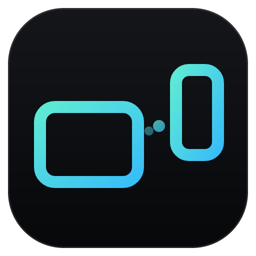

# Veydrop

### From screen to screen.

Move files between your Windows PC and your phone over your own Wi-Fi, in both directions.<br>
The phone needs only a browser: no app, no account, no cloud.

<p>
  
  
  
  
  
  
</p>

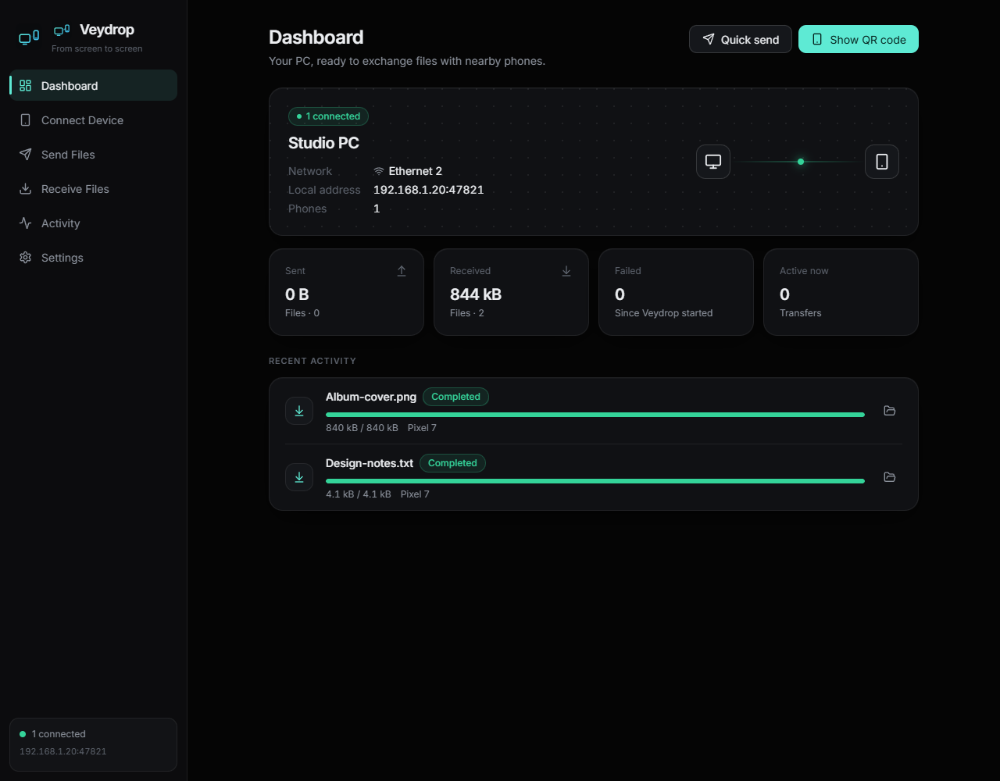

<sub>Real capture of the release build with made-up sample data. See <a href="#11-screenshots-and-demonstrations">how the screenshots were made</a>.</sub>

</div>

> **Status: 1.0.0. Verified by automated tests, browser emulation and local Windows runs, but not yet on physical phones.**
> No real iPhone or Android device has been used to test Veydrop. Please run the [device test checklist](docs/DEVICE_TEST_CHECKLIST.md) before relying on it. The installer is unsigned. See [Known limitations](#19-known-limitations).

---

## Contents

1. [Hero and branding](#veydrop)
2. [Product overview](#2-product-overview)
3. [Feature highlights](#3-feature-highlights)
4. [Application preview](#4-application-preview)
5. [How Veydrop works](#5-how-veydrop-works)
6. [Phone-to-PC transfers](#6-phone-to-pc-transfers)
7. [PC-to-phone transfers](#7-pc-to-phone-transfers)
8. [QR pairing and security](#8-qr-pairing-and-security)
9. [Automatic language synchronization](#9-automatic-language-synchronization)
10. [Arabic and English support](#10-arabic-and-english-support)
11. [Screenshots and demonstrations](#11-screenshots-and-demonstrations)
12. [Installation](#12-installation)
13. [Windows Firewall and network setup](#13-windows-firewall-and-network-setup)
14. [Technology stack](#14-technology-stack)
15. [Development setup](#15-development-setup)
16. [Production build](#16-production-build)
17. [Project structure](#17-project-structure)
18. [Privacy and security](#18-privacy-and-security)
19. [Known limitations](#19-known-limitations)
20. [Troubleshooting](#20-troubleshooting)
21. [Contributing](#21-contributing)
22. [License](#22-license)

---

## 2. Product overview

Veydrop is a Windows desktop application. While you have a connection turned on, it serves a small web page on your local network. You open that page on your phone by scanning a QR code, approve the phone on the PC, and then send files to the PC or download files from it.

Everything stays on your network. There is no account, no server on the internet, no telemetry and no phone app to install.

---

## 3. Feature highlights

| | |
| --- | --- |
| **Both directions** | Phone to PC and PC to phone, including multiple files and whole folders. |
| **Browser only on the phone** | Safari on iPhone and Chrome on Android are the targets. Nothing to install. |
| **QR pairing with PC approval** | A one-time QR code, a 4-digit code shown on both screens, and an explicit **Approve** click on the PC for every new phone. |
| **Checked transfers** | Uploads are chunked, resumable within a live session, and verified with SHA-256. A damaged transfer is reported as failed, never as success. |
| **You choose what is shared** | The phone sees only the items you add to the Send list. File paths are never exposed to it. |
| **Language follows the PC** | The language chosen on the PC (English or Arabic) is applied to the phone automatically and live. |
| **Arabic and English, RTL and LTR** | Full right-to-left layout, bundled Inter and IBM Plex Sans Arabic fonts. |
| **Dark, light and system themes** | On the PC and on the phone. |
| **Tray, diagnostics, history** | Tray menu, close-to-tray, a read-only connection diagnostics panel, and a local transfer history you can clear. |
| **Local only** | Listens only on the network interface you choose, and only while a connection is on. |

---

## 4. Application preview

<div align="center">
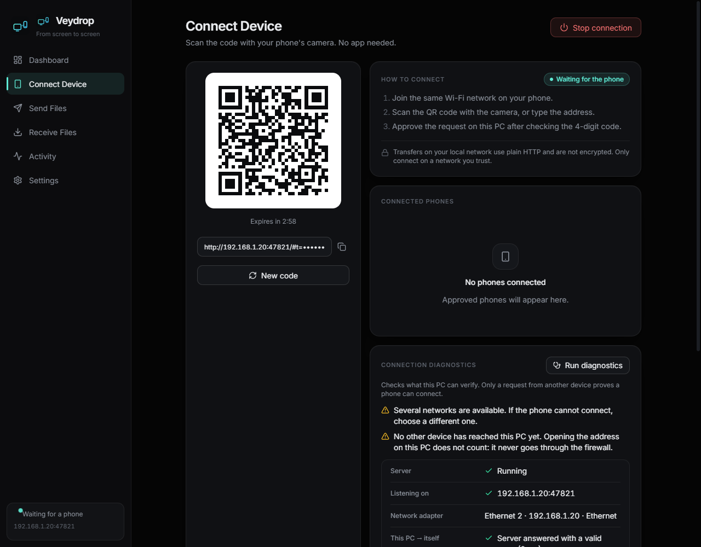
</div>

The **Connect Device** page shows the QR code and the address. A phone on the same Wi-Fi opens it, and the PC user then approves the phone.

---

## 5. How Veydrop works

```text
   Phone browser                                     Windows PC
  ┌──────────────┐     plain HTTP on your LAN     ┌───────────────────────────┐
  │ Veydrop web  │ ─────────────────────────────▶ │ Veydrop (Tauri shell)     │
  │ app (React)  │ ◀───────────────────────────── │  └ Rust engine + Axum     │
  └──────────────┘      session cookie + SSE      │     serves the phone UI   │
                                                  └───────────────────────────┘
```

1. On the PC you press **Start connection**. Veydrop binds to the IP address of the network adapter you chose and shows a QR code.
2. The phone scans the QR code and opens the address. The one-time token travels in the URL *fragment*, which browsers do not send to servers.
3. The PC shows an approval request with a 4-digit code. The phone shows the same code. You compare them and press **Approve**.
4. The phone receives a session cookie and the web app is unlocked. Live updates (transfer progress, language changes, revoked sessions) arrive over Server-Sent Events.
5. You send or receive files. Stopping the connection revokes every session at once.

---

## 6. Phone-to-PC transfers

1. On the phone choose **Send to PC**, then pick files or a folder.
2. The PC shows an **Incoming files** request listing what the phone wants to send. Nothing is written to disk until you press **Accept** (or turn off "ask before receiving" in Settings).
3. Data is uploaded in chunks to a temporary partial file and hashed with SHA-256 while streaming. Only when the hash the phone declared matches is the file moved into your receive folder. A mismatch deletes the data and reports failure.
4. Names are sanitized on the PC, and existing files are never overwritten; duplicates get a numbered name.

<div align="center">
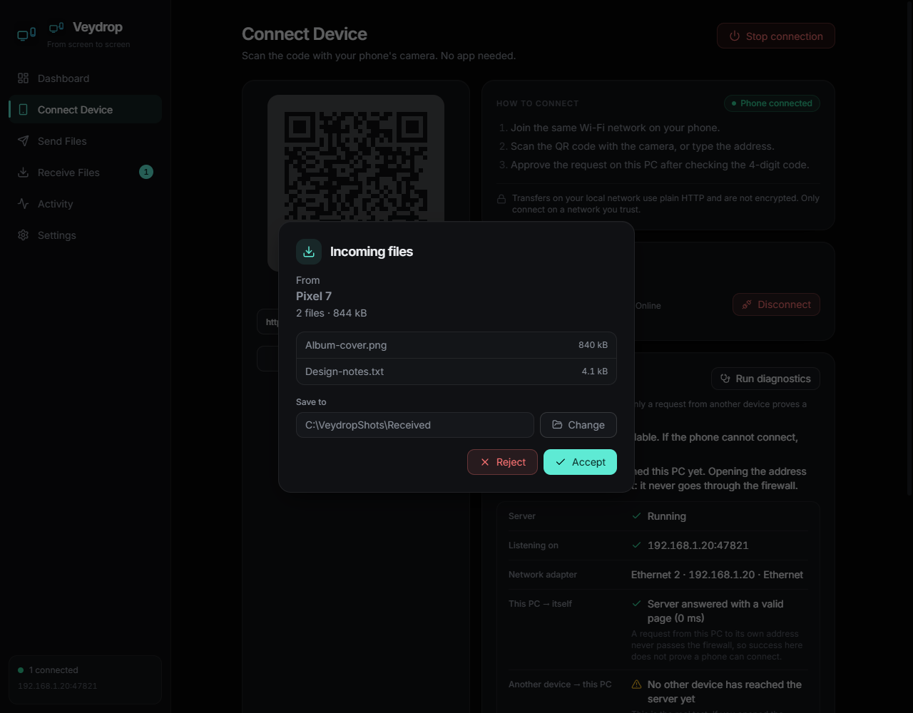
</div>

---

## 7. PC-to-phone transfers

1. On the PC open **Send Files** and add files or folders to the list, then turn sharing on.
2. On the phone choose **Receive from PC**. It lists exactly the items you shared.
3. Files are served with range support. Several items, or a folder, can be downloaded as a streamed ZIP (stored, no compression).
4. If a shared file changes on disk after you added it, the download fails instead of serving inconsistent data.

<div align="center">
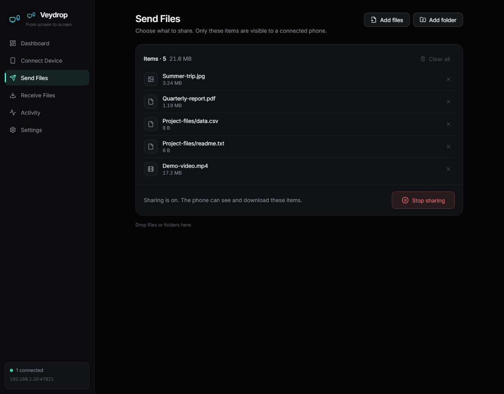
</div>

---

## 8. QR pairing and security

- **One-time token.** The QR code carries a random 16-byte token in the URL fragment. The PC keeps only its SHA-256 hash. It is single use and expires (default 180 seconds, configurable).
- **Approval on the PC.** Presenting the token creates a pending request. A person must approve it. Requests time out after 90 seconds.
- **The pairing code is always ASCII digits.** The 4-digit code uses `0-9` in every language, on the PC and on the phone. It is never localized to Arabic-Indic digits, it is displayed left-to-right and isolated from surrounding right-to-left text, uses tabular numerals, and keeps leading zeros (`0042` stays `0042`).
- **The code belongs to one attempt.** The PC's approval dialog and the phone's waiting screen show the code of the same request id, and decisions resolve strictly by that id. Rejecting or expiring one attempt cannot approve another. This is covered by automated tests for English, Arabic, leading zeros, concurrent requests and expiration.
- **Sessions.** The approved phone gets an `HttpOnly`, `SameSite=Strict` cookie. Only a hash of the session token is kept on the PC. Sessions expire, and stopping the server or disconnecting a phone revokes them immediately.
- **Request checks.** Host and Origin checks, a required custom header on writes, a strict Content-Security-Policy, rate limiting and lockout.

<div align="center">
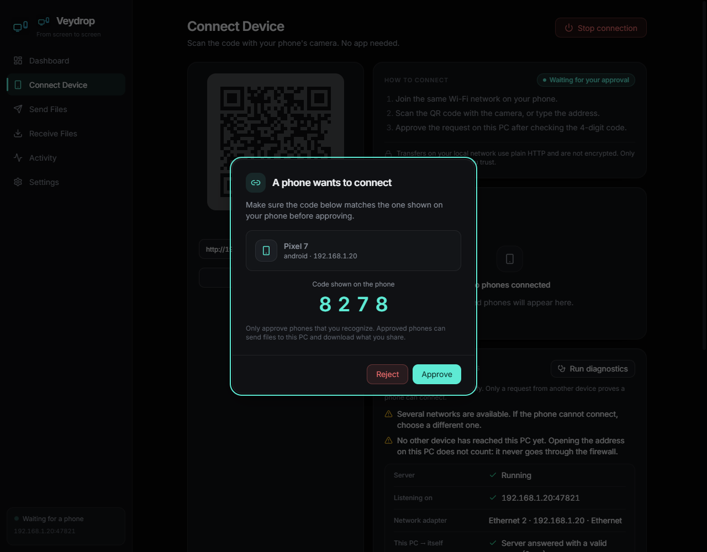
</div>

> **No end-to-end encryption.** Traffic on the local network is plain HTTP. See [Privacy and security](#18-privacy-and-security).

Full details and threat model: [docs/SECURITY.md](docs/SECURITY.md).

---

## 9. Automatic language synchronization

The language chosen on the PC is the single source of truth. The phone follows it automatically.

- It is delivered to the phone with the pairing result and the session bootstrap response, so a freshly paired or reconnecting phone starts in the right language.
- A change in the PC's Settings is pushed to connected phones over the live event stream. The phone switches immediately: no QR rescan, no disconnect, no page reload, and running transfers are not interrupted.
- The phone's own browser language does not override it after pairing, and the phone has no language selector.
- The language is saved with the PC's settings and survives a restart. If the PC is set to "System", the PC resolves the system language to English or Arabic and sends that resolved value.
- The phone cannot set or report the language, so there is no feedback loop. A `language` event is sent only when the effective language actually changes.

<div align="center">
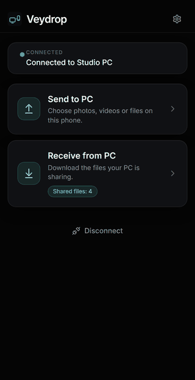
</div>

<sub>The animation is a slideshow of two real emulated-phone captures (English, then Arabic after the PC changed language). It is not a screen recording.</sub>

---

## 10. Arabic and English support

Both interfaces (desktop and phone) are fully translated into English and Arabic, with right-to-left layout for Arabic. Automated tests check that both language files have exactly the same keys on both sides, that no key falls back to another language, and that placeholders such as `{{name}}` are filled with values.

<div align="center">
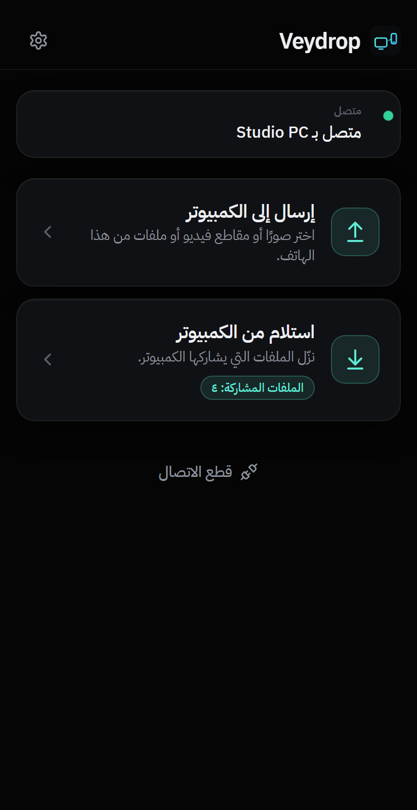
</div>

<sub>Browser emulation (Chromium with a phone-sized viewport), not a physical phone.</sub>

---

## 11. Screenshots and demonstrations

**How these were made, honestly:**

- **Desktop screenshots** are captures of the real release build of Veydrop (`veydrop.exe`) run on Windows from a scratch copy, with its settings, history and downloads in a throwaway data folder (`VEYDROP_DATA_DIR`). Only the application's web contents are captured. The sample files have made-up names and random contents, the LAN address is masked, and the one-time pairing token was destroyed right after the capture. The QR codes shown come from that throwaway session and no longer work.
- **Mobile screenshots** are rendered by a desktop Chromium in phone-sized emulation against a local test engine. They are **browser emulation, not a physical iPhone or Android phone**.
- **The two GIFs** are slideshows of real captures. They are not screen recordings.

### Desktop

| Dashboard | Connect Device |
| --- | --- |
|  |  |

| Send Files | Receive Files |
| --- | --- |
|  | 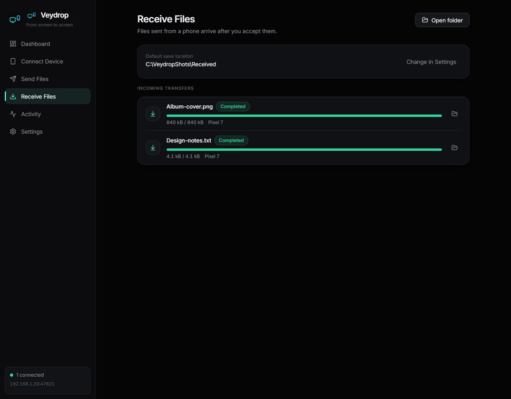 |

| Activity | Settings |
| --- | --- |
| 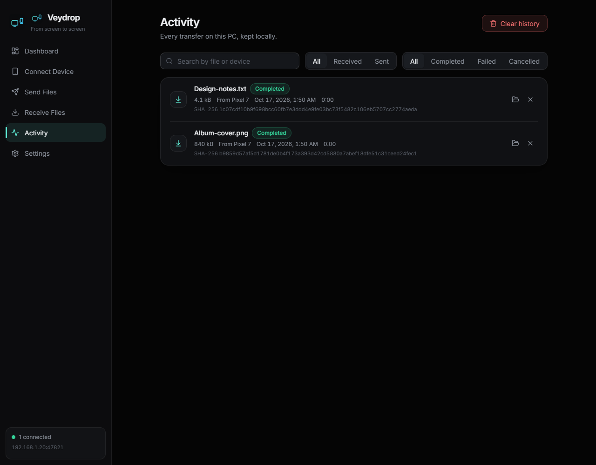 | 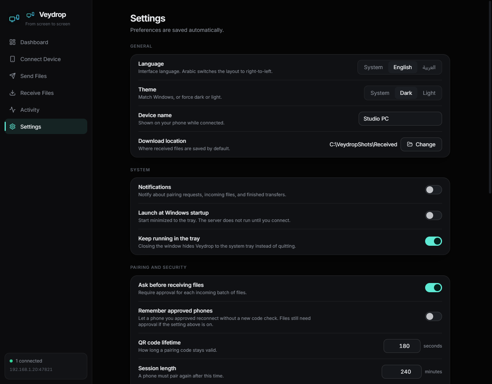 |

| Phone approval | Connect Device with a paired phone |
| --- | --- |
|  | 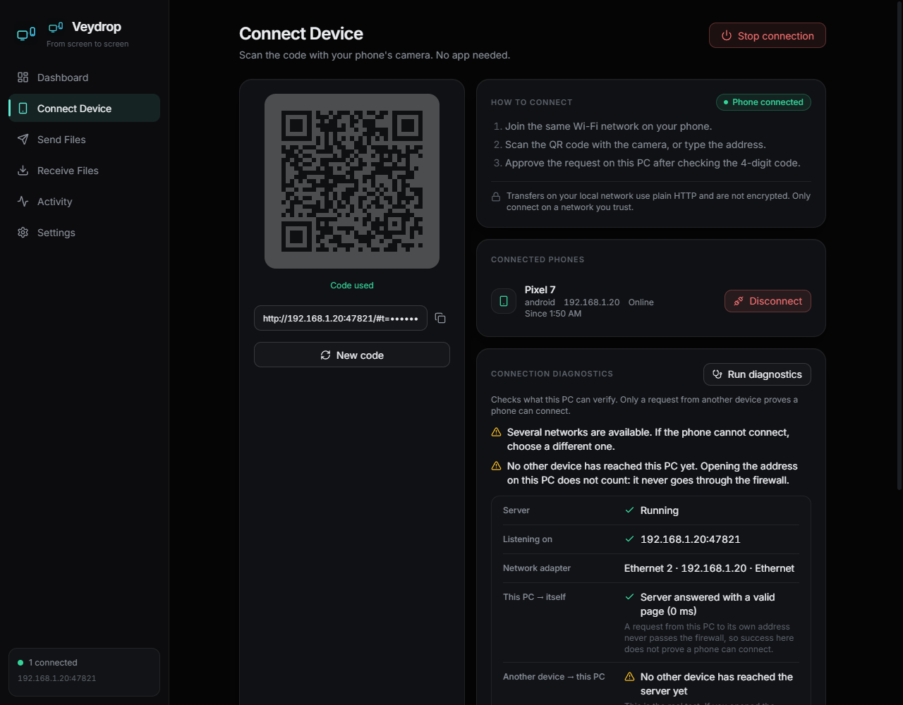 |

### Phone (browser emulation)

| Connection screen | Home | Send to PC | Receive from PC |
| --- | --- | --- | --- |
| 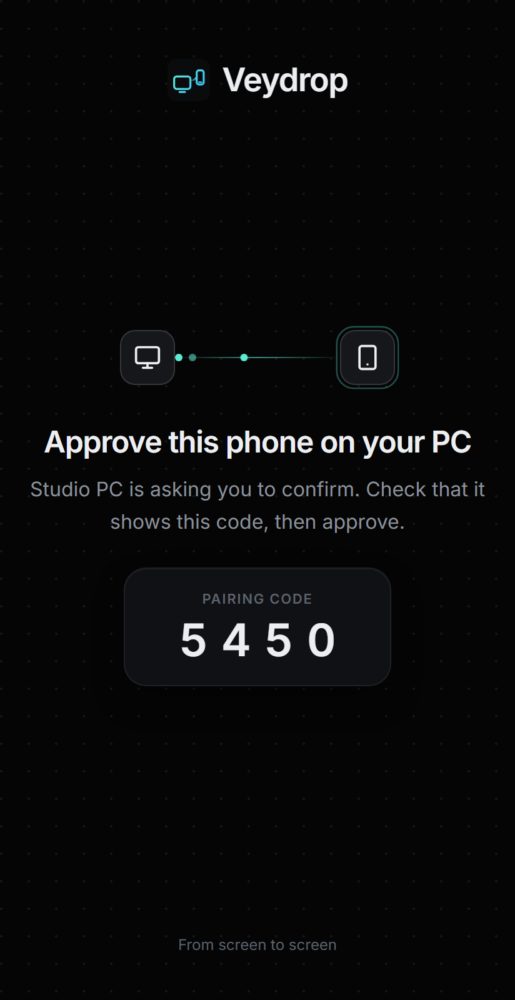 | 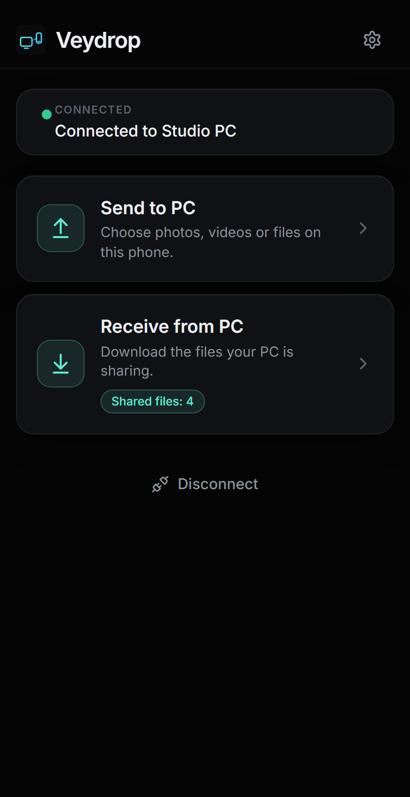 | 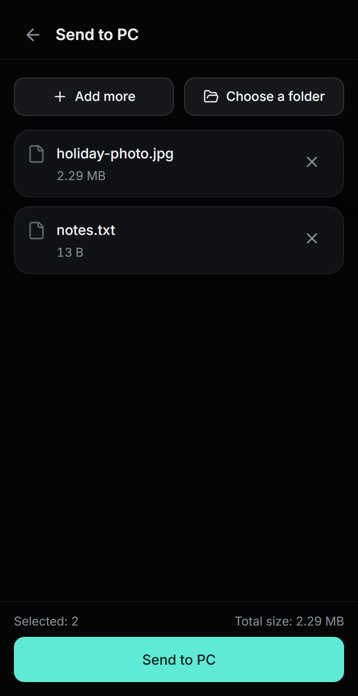 | 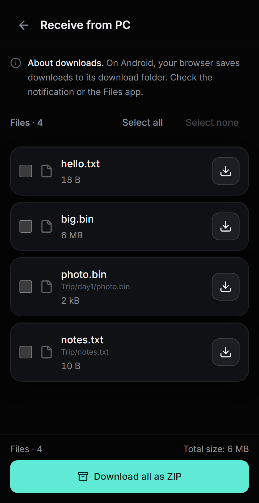 |

| Light theme | Arabic (RTL) |
| --- | --- |
| 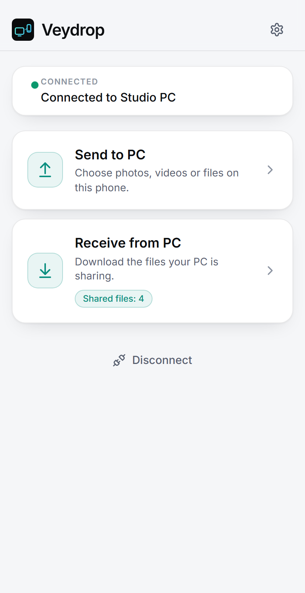 |  |

### Pairing flow (slideshow of real desktop captures)

<div align="center">
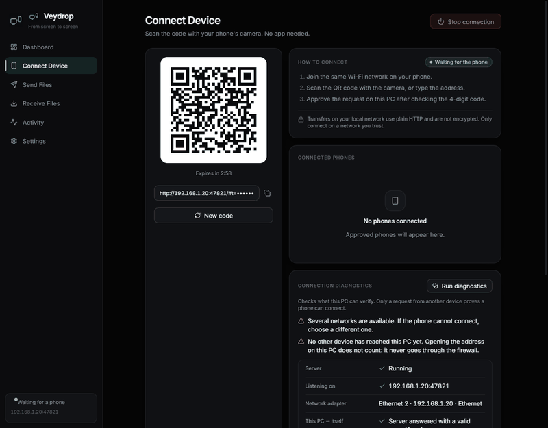
</div>

Regenerate them yourself (see [Development setup](#15-development-setup)):

```bash
cd e2e
node screenshots/desktop-shots.mjs                                              # desktop, needs a built release exe
COMPUTERNAME="Studio PC" npx playwright test -c playwright.shots.config.ts     # phone (emulation)
```

---

## 12. Installation

**Requirements:** Windows 10 or 11, 64-bit. The installer fetches Microsoft's WebView2 runtime if it is missing (Windows 11 and current Windows 10 already include it).

This repository does not publish a download. Build the installer yourself (see [Production build](#16-production-build)); it is produced at:

```text
target/release/bundle/nsis/Veydrop_1.0.0_x64-setup.exe
```

It is about 3.2 MiB and installs per user without administrator rights.

> **The installer is not code signed.** Windows SmartScreen will show "Windows protected your PC" with an unknown publisher. That is expected for an unsigned build. Choose **More info**, check that the file is the one you built, then **Run anyway**. Only do this for an installer you built yourself or otherwise trust.

> **Installer testing status.** The installer was built and its metadata (name, version 1.0.0, icon, no signature) was checked, but it has **not been installed, launched or uninstalled** through the installer in a clean or isolated environment. The app itself (`veydrop.exe`) was run locally on Windows for testing and for the screenshots.

### Using it

1. Open Veydrop, go to **Connect Device** and press **Start connection**. Veydrop only listens on the network while a connection is on.
2. If Windows Defender Firewall asks, allow Veydrop on a **Private** network (see the next section).
3. Join the same Wi-Fi network on the phone and scan the QR code, or type the address shown.
4. Compare the 4-digit code on both screens and press **Approve** on the PC.
5. On the phone choose **Send to PC** or **Receive from PC**. On the PC, **Send Files** chooses what the phone can see and **Receive Files** is where incoming files are accepted.

Phone browser requirements: roughly **iOS/Safari 16.4 or newer, or Chrome 111 or newer** on Android. Folder upload support varies by browser.

---

## 13. Windows Firewall and network setup

Veydrop **never changes your firewall** and does not need it turned off. Never disable Windows Defender Firewall for Veydrop.

If a phone cannot open the page while the PC itself can, Windows is probably blocking incoming connections on that network:

1. **Mark your home Wi-Fi or Ethernet network as Private.** Windows Settings → Network & internet → your connection → *Network profile type* → **Private network**. Only do this on a network you trust.
2. When Windows shows its firewall prompt for Veydrop, tick **Private networks** and choose **Allow**. Do not allow Public networks.
3. If you dismissed the prompt earlier, open Windows Security → Firewall & network protection → *Allow an app through firewall* and enable **Private** for Veydrop.
4. Make sure the phone and PC are on the same network. Guest Wi-Fi, "AP/client isolation" and VPNs can block it.

Veydrop's **Connect Device → Run diagnostics** inspects the server, the chosen adapter, a real local HTTP check, the Windows network profile and the firewall (read-only), and whether another device has actually reached the server. It can show a narrowly scoped PowerShell command (this program, TCP 47821–47900, local subnet, current profile) for you to copy. **Veydrop never runs it.**

If the phone and PC are on different subnets, or the network isolates clients, use your phone's own hotspot or another network.

---

## 14. Technology stack

| Layer | Technology |
| --- | --- |
| Desktop shell | Tauri 2 (Rust), WebView2, NSIS installer |
| Engine | Rust 2021, Tokio, Axum 0.8 (HTTP, SSE), SHA-256 verification |
| Desktop UI | React, TypeScript, Vite 6, Tailwind CSS 4 |
| Phone web app | React, TypeScript, Vite, Tailwind CSS 4, served by the Rust engine |
| Fonts | Inter, IBM Plex Sans Arabic (SIL OFL 1.1, bundled) |
| Tests | Rust unit and integration tests, Vitest, Playwright (Chromium and WebKit) |

---

## 15. Development setup

**Prerequisites:** Windows 10/11, Node.js 20, Rust stable with the MSVC toolchain (1.97 was used), the [Tauri 2 prerequisites for Windows](https://v2.tauri.app/start/prerequisites/) (Visual Studio Build Tools, WebView2).

```bash
cd desktop
npm install
npm --prefix ../mobile install
npx tauri dev            # development run
```

### Tests

```bash
cargo test -p veydrop-core                 # Rust unit + real-HTTP integration tests
(cd desktop && npm test)                   # desktop UI unit tests
(cd desktop && npx tsc --noEmit -p .)      # desktop type check
(cd mobile && npm test)                    # phone web app unit tests
(cd mobile && npm run build)               # rebuild the bundle the e2e tests serve
(cd e2e && npm install && npm run install-browsers && npm test)   # Playwright, Chromium + WebKit
```

The end-to-end tests run the phone web app in Playwright against the **real Rust engine**, started by `crates/veydrop-core/examples/e2e_harness.rs`. That harness is **test tooling only**: it stands in for the person at the PC (approving pairing, accepting offers, switching language) through stdin commands, and is not part of the shipped app. The two Playwright profiles are *emulation* (Pixel 7 on Chromium, iPhone 14 on Playwright's WebKit build); they are not real devices and Playwright's WebKit is not iOS Safari.

Rebuild the mobile bundle after any mobile source change, because the e2e tests serve the built bundle. Latest recorded results: [DEVELOPMENT_STATUS.md](DEVELOPMENT_STATUS.md).

### Isolating a run from your real data

Set `VEYDROP_DATA_DIR` to a scratch folder to make the app keep its settings and history there instead of your user profile. The screenshot script uses this so captures never touch real data.

---

## 16. Production build

```bash
cd desktop
npx tauri build
```

This builds the phone web app into `desktop/src-tauri/resources/mobile` (served by the Rust server and bundled into the installer), then the desktop UI, then the release binary and the NSIS installer:

```text
target/release/veydrop.exe
target/release/bundle/nsis/Veydrop_1.0.0_x64-setup.exe
```

The installer bundles the app, the phone web app, English and Arabic strings, fonts and icons. It does not need a dev server.

---

## 17. Project structure

| Path | Contents |
| --- | --- |
| `crates/veydrop-core` | Rust engine: auth and pairing, Axum server, transfer engine, history, settings, network detection, diagnostics |
| `desktop/` | Tauri 2 shell (`src-tauri`) and the React desktop UI (`src`) |
| `mobile/` | Phone web app (React), built into the app resources |
| `shared/` | Design tokens and formatting shared by both UIs |
| `e2e/` | Playwright tests, the engine test harness and the screenshot generators |
| `docs/` | Security, limitations, troubleshooting, device checklist, screenshots and demos |
| `branding/`, `scripts/` | Original logo and icons, and the icon renderer |
| `licenses/` | Font licenses |

---

## 18. Privacy and security

- Nothing leaves your network. No accounts, no telemetry, no analytics, no update checks.
- The server listens only on the interface you choose and only while a connection is on. It stops when you stop it or quit.
- Tokens and cookies are never written to logs. Transfer history is stored locally and can be cleared.
- Path traversal, reserved Windows names, absolute paths and ZIP abuse are handled server-side; incoming data goes to a temporary file and is only moved into place after SHA-256 verification.
- **Traffic on the local network is plain HTTP and is not encrypted.** Veydrop does **not** provide end-to-end encryption. Anyone on the same network who can capture traffic can read what you transfer and the session cookie. Use a network you trust, or your own phone hotspot, and disconnect when you are done.
- This has not been through an independent security audit.

Read [docs/SECURITY.md](docs/SECURITY.md) for the details.

---

## 19. Known limitations

- **Not tested on physical devices.** Phone behaviour was checked only with browser emulation.
- **Installer not install-tested** in an isolated environment, and **unsigned** (SmartScreen warning).
- Plain HTTP on the LAN; same reachable network required; IPv4 only for pairing URLs.
- No silent saves: the phone's browser decides where downloads go. iPhone backgrounding or screen lock can suspend a transfer; keep the page open.
- Downloads cannot be verified on the phone; uploads are SHA-256 verified.
- ZIP downloads are stored (uncompressed), up to 5,000 items and under 4 GiB.
- Windows 10/11 x64 only. English and Arabic only.

The complete list is in [docs/LIMITATIONS.md](docs/LIMITATIONS.md).

---

## 20. Troubleshooting

| Symptom | Likely cause and fix |
| --- | --- |
| Phone says the server stopped responding or times out | Windows Firewall is blocking the connection on a Public network. See [section 13](#13-windows-firewall-and-network-setup). |
| QR code "expired" or "already used" | Each QR code is single use and short lived. Press **New code** on the PC. |
| Phone opens the page but nothing happens after scanning | Compare the 4-digit code and press **Approve** on the PC. |
| Connection broke after sleep or a Wi-Fi change | The PC's address changed. Start the connection again and scan the new QR code. |
| Transfer stops when the phone locks | The browser suspended the page. Keep the screen on; it resumes when the page returns. |

More in [docs/TROUBLESHOOTING.md](docs/TROUBLESHOOTING.md) and the [device test checklist](docs/DEVICE_TEST_CHECKLIST.md).

---

## 21. Contributing

Issues and pull requests are welcome. Before you open a pull request, please run the test commands in [Development setup](#15-development-setup) and describe which ones you ran. Keep English and Arabic strings in step (the localization tests fail if the files diverge), and do not add claims to the docs that were not tested.

---

## 22. License

This repository does not currently include a `LICENSE` file, so no open-source license is granted at this time. The Cargo workspace manifest carries a `license = "MIT"` metadata field, but that is not a substitute for a license file. A license should be chosen and added by the project owner.

Bundled fonts keep their own licenses: Inter and IBM Plex Sans Arabic are under the SIL Open Font License 1.1 (see [licenses/](licenses/)). Third-party Rust and npm dependencies keep their own licenses. The Veydrop name and logo are original to this project.
